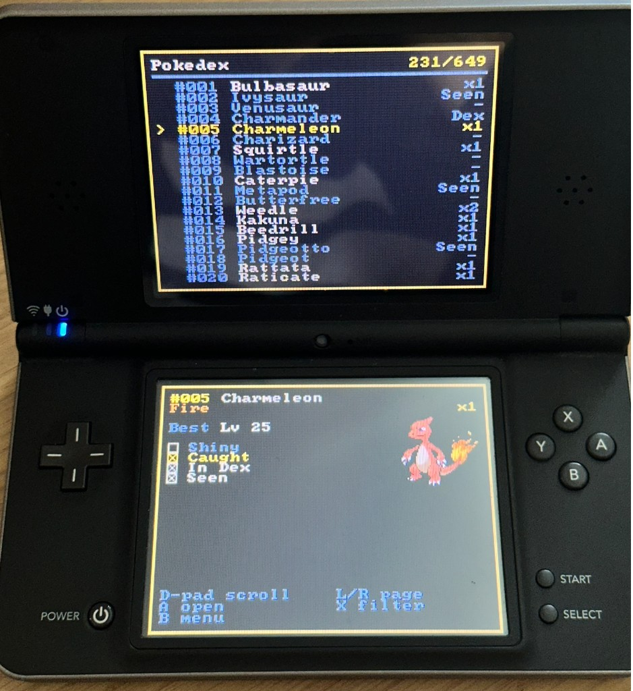

# PokeVault

Every save on the card, gathered into one National Dex.

Boot it on a DS that already runs homebrew. PokeVault walks the SD card, reads the Pokémon saves it finds, and lays them out as a single Pokédex from Bulbasaur to Genesect. Generation 3, 4, and 5 share the list. Open a species and every copy you have is there: level, nature, moves, the ball it was caught in, and the game it came from. A shiny shows its shiny sprite.

A trade evolution can be sent out and back from the Evo page, and a Pokémon can be sent into another save from the Send page. Both of those write the saves. Which games are hidden, and which design you picked, are kept in PokeVault's own settings file.

An unofficial fan tool, not affiliated with Nintendo, Game Freak, or The Pokémon Company.

**Download:** [pokevault.nds](pokevault.nds)

Or build it from this source.

## What it does

Put your `.sav` files on the card, boot `pokevault.nds`, and it walks the card looking for them. Generation 3, 4, and 5 saves are mixed into one list, species #001 through #649.

Each species shows whether you have a copy stored, whether a save has it marked caught or seen, and whether you have a shiny. Open a species and every copy is listed with its level, nature, and which box or party slot it sits in.

A single Pokémon shows:

- Its nickname, when it has one
- Level, nature, gender, and calculated battle stats, drawn as bars
- Its ability and held item
- Its four moves
- The ball it was caught in, and the date, when the save has one
- Where it was caught, and which game it came from
- Which file it came from, and its box or party slot
- The Pokédex entry
- Type weaknesses
- The evolution line. The sprite follows the stage you are on, and the method is the one for that copy's game
- A sprite, including the shiny sprite

The home menu also has a Games page, a Progress page, and a Designs page. Games lists each save with the trainer name, money, play time, and Pokédex count. Open a save to see its party and boxes. Progress is a living dex across the saves left switched on. The top screen is the bar and the five regions. The bottom screen is the highlighted region's ladder: in the dex, living, shiny, seen, and never seen. A copy in a box counts as living, and also as in the dex and seen. Shiny is part of that living count. A region reads Complete once a hatched copy of each of its species is in a box. Eggs do not fill a spot. It also counts the formes you have for Unown, Shellos, Rotom, Deerling, and the other shapes the saves record.

## Trade evolutions

Open a Pokémon and switch to Evo. When the line says Y trade, that copy can be sent out and come back evolved. A asks to go ahead, and B cancels. If a held item is still missing, the line names it.

The species in that box or party slot changes. Friendship is set to the new species' base, and a held item the evolution asks for is used up. A plain trade, such as Kadabra or Graveler, needs nothing held. The new species is marked caught in that save's Pokédex. A party Pokémon has its battle stats recalculated. Eggs are left alone.

This writes that one save. The previous file is kept as a `.bak` beside it.

Ruby, Sapphire, Emerald, FireRed, LeafGreen, Diamond, Pearl, Platinum, HeartGold, SoulSilver, Black, White, Black 2, and White 2 can be written this way. Feebas still needs high Beauty until Generation 5, so a Prism Scale trade is only offered on a Generation 5 save. Rhyperior, Electivire, Magmortar, Porygon-Z, and Dusknoir are Generation 4 trades. Boldore and Gurdurr are Generation 5 trades. Karrablast and Shelmet are not on that list. They evolve only when one is sent for the other.

## Sending a Pokémon

Open a Pokémon and switch to Send. The list is only the saves that can take it. A save that cannot is left off, and one short line says why: badges, the generation, no room, an egg, mail, the last one, or its item.

Both saves need 8 gym badges. On HeartGold and SoulSilver that is the Johto set. Eight Kanto badges, with Johto unfinished, do not count.

A same-generation send can go either way. Generation 3 moves forward into Generation 4 through Pal Park. Generation 4 moves forward into Generation 5 through Poké Transfer. Nothing moves backward, and Generation 3 does not skip ahead to Generation 5. Pal Park and Poké Transfer do not evolve. A move inside a generation does, by the same trades as the Evo page, and a held item those ask for is used up.

The Pokémon is copied from the slot as the game stored it. It leaves the source save, so it is not cloned. It arrives in the first empty box slot, or the first empty party slot when the boxes are full. The destination Pokédex marks the arrival caught and seen. The source Pokédex is left as it was.

Eggs can move inside a generation. An egg does not cross a generation. Mail has to come off first. A held item Pal Park has no index for has to come off first. Poké Transfer drops a legal held item, and does not put it in the bag. The last Pokémon in a save stays there.

A asks, A sends, and B backs out. Both saves are written. Each current file is kept as a `.bak` beside it. If the second save cannot be put in place, both files are put back.

## Designs

Designs is on the home menu. The count, such as 3/14, is how many of the 14 cartridges are unlocked. Gold on black is always there. Each cartridge adds one palette once a save of that game has its 8 gym badges. Ruby and Sapphire can trade before a ROM says which one the save is. Until then that pair unlocks neither design. The special design unlocks when all 14 titles are known and each has 8 gym badges on at least one save.

The choice is remembered in the settings file. The unlocks are counted again every boot from the saves on the card. Removing a save locks that design again. A selected design that is no longer unlocked falls back to gold on black until the save comes back.

A sibling ROM names the cartridge. It is the same file name beside the save, or in the parent folder when the save sits in `saves`. The game code is read from that ROM. An unknown code stays on the pair label and unlocks nothing.

## Saves it reads

- Ruby and Sapphire
- Emerald
- FireRed and LeafGreen
- Diamond and Pearl
- Platinum
- HeartGold and SoulSilver
- Black and White
- Black 2 and White 2

Files need a `.sav` extension. It looks through the whole card, and skips `_nds`, `hiya`, `gm9`, `dcim`, and `private`. If it finds nothing, the usual places are `roms/nds/saves` and `roms/gba`.

It keeps up to 48 saves and 16,384 Pokémon. Past that, the list says it is full.

## Controls

**Home**

- Up and Down move between Pokédex, Games, Progress, and Designs
- A opens the one you are on
- Designs shows how many of the 14 looks are unlocked, such as 3/14

**Pokédex**

- Up and Down scroll, Left and Right move one line, L and R turn the page
- A opens that species
- Y finds a species by name, or by a nickname on a stored copy
- X opens the filter
- B returns to the menu

**A species**

- On Stats, Entry, and Weak, Up and Down move between copies
- L and R switch the bottom screen between Stats, Entry, Weak, Evo, and Send
- On Evo, Up and Down move through the line. The sprite follows that stage, and the method under the line is the one that copy's game uses. A opens that species. One you have stored is bright, a shiny is marked shiny, and one you lack is dim
- On Evo, Y trades the copy you are on when that game evolves it by trade. A held item has to be the one that evolution asks for, and that item is used up. A asks to go ahead, and B cancels. The previous save is kept as a `.bak` next to it. Karrablast and Shelmet are not offered here
- On Send, Up and Down move through the saves that can take this Pokémon. A asks, A sends, and B backs out. Both saves get a `.bak`. The line under the list is why another save was left off
- A, or a tap on a move, highlights that move. A again opens it. Up and Down move the highlight, and B leaves it
- On a move, Up and Down switch moves, and B returns to the highlight
- B goes back to the list. Opened from a party or box, B returns there

**Filter**

- Caught: stored in a box or the party
- Seen: marked seen in a Pokédex
- In Dex: marked caught in a Pokédex
- Shiny: a shiny copy is stored
- Games: turn individual saves on or off. Off also hides that save from the Games list, and the choice is kept on the card
- Pokédex: the full National Dex, or only Kanto, Johto, Hoenn, Sinnoh, or Unova

A toggles a row. On Games or Pokédex, A opens that list. B goes back, and from the top of the filter it closes it.

**Find**

- Up and Down, Left and Right move through the letters
- A types the letter. Delete and Clear are at the bottom
- B deletes a letter, and leaves Find when the query is empty
- Y closes Find and keeps the query

**Games**

- Up and Down scroll the save list. A save set to Off in the filter is left out
- Y asks to hide the save you are on. A hides it, and B cancels. That is the same switch as Filter, Games, Off, and it is still hidden next boot
- Turn a hidden save back on from the Pokédex filter, under Games
- A opens that save's party and boxes
- In the party and boxes, each Pokémon shows as its sprite. A shiny uses the shiny sprite. An egg shows as an egg
- The D-pad moves a hand from slot to slot. L and R change box, and A opens that Pokémon
- B from that Pokémon returns to the party or box you opened it from
- B from the boxes returns to the save list, and from the save list to the menu
- HeartGold and SoulSilver show the 8 Johto badges. The Kanto count is beside that, and it does not fill the 8

**Designs**

- Up and Down move through Default, the 14 cartridges, and the special design
- A locked row stays dim. A uses an unlocked one, including Default
- B returns to the menu

**Progress**

- Up and Down move between Kanto, Johto, Hoenn, Sinnoh, and Unova
- A opens the species from that region that are still missing from a box. Registered holes come first, then seen, then never seen
- On that list, A opens a species. B returns to Progress
- When nothing is missing, the list reads Complete
- B returns to the menu

## Running it

It runs on a DS that already boots homebrew. That includes TWiLight Menu++ on a DSi or 3DS, and a DS or DS Lite with a flashcart running TWiLight Menu or its own kernel. Copy `pokevault.nds` onto the same SD card the menu uses, usually into `roms/nds`, and launch it from the menu like any other homebrew.

The saves can stay where TWiLight already put them. DS saves sit next to the ROM or in `roms/nds/saves`. GBA saves, from GBARunner, sit in `roms/gba`. PokeVault walks the card and reads those `.sav` files in place. It skips TWiLight's own `_nds` folder, and also skips `hiya`, `gm9`, `dcim`, and `private`, so the menu's files are left alone. Scanning only reads saves. A Generation 3, 4, or 5 trade writes the one save you confirmed, and leaves a `.bak` beside it. Sending a Pokémon writes both saves, leaves a `.bak` beside each, and puts both back if the second file cannot be renamed into place. The hidden-game choice and the selected design are written to `_nds/pokevault/settings`. Designs are unlocked from the badges on the card each boot, not from that file.

Sprites and music are packed inside `pokevault.nds`. The Pokémon data comes from the SD card. TWiLight Menu tells the homebrew where that `.nds` file is, which is what those packed files need. The dex still opens if a loader omits that path. The sprites and music are just blank.

Building it needs [devkitARM](https://devkitpro.org/wiki/Getting_Started). Run `./install.sh` first. It shows whether the sprites and the two songs are present, then helps with whichever one you choose. Sprites download into `nitro/sprites.bin`, which is not kept in git. Songs are two WAV files you convert yourself. From this folder, `make` writes `pokevault.nds` with those songs packed in, and `pokevault-nomusic.nds` without them. Copy the `.nds` you want onto the SD card. `make -f Makefile.host test` runs the save-parsing checks on a computer, with no DS compiler.
